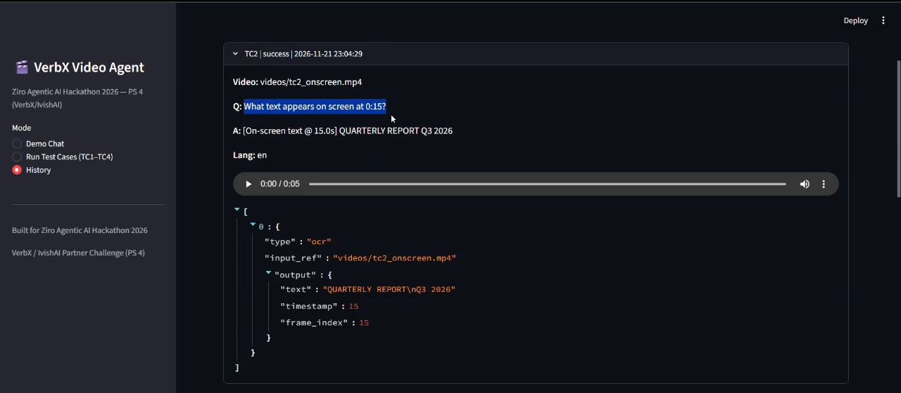

# 🎬 VerbX Multilingual Video Understanding Agent

> **Ziro Agentic AI Hackathon 2026 — VerbX / IvishAI Partner Challenge (PS 4)**

An AI agent that answers contextual questions about video content — dialogue, on-screen text, and scenes — **by voice** with **precise timestamps**, in the **questioner's language**.



*TC2 demo result: the agent reads "QUARTERLY REPORT Q3 2026" at 15.0s and returns the exact timestamp and frame index.*

**Demo video:** [Watch the 35-second TC2 walkthrough](docs/VerbX_TC2_Demo_35s.mp4) — burned-in captions, instrumental music, no voiceover.

## 🎯 Problem Statement

Build an intelligent agent that:
- **Understands** video scenes, dialogue, and visible text using VerbX APIs
- **Answers** contextual questions **by voice** with **accurate timestamps**
- **Speaks** in the **questioner's language** (multilingual support)
- **States** when something **cannot be seen or heard** (no hallucination — guardrails)
- Uses **only licensed/CC0 videos** (responsible AI)

## 🏗️ Architecture

```
Video (MP4) → ffmpeg Processor
  ├─ Audio (16kHz WAV) → VerbX STT → Transcript + Timestamps
  ├─ Frames (1 fps JPEG) → VerbX OCR → On-screen Text + Positions  
  ├─ Frames (1 fps JPEG) → VerbX Image Assist → Scene Descriptions
  └─ Combined Evidence → Agentic Reasoning Engine
        ├─ Evidence Found → Answer with Timestamps
        ├─ No Evidence → Guardrail: "Cannot see/hear"
        ├─ VerbX Translation → Target Language
        └─ VerbX TTS → Voice Answer
```

See [ARCHITECTURE.md](ARCHITECTURE.md) for detailed Mermaid diagrams and API flow sequences.

## 🔧 VerbX APIs Used

| API | Endpoint | Purpose |
|-----|----------|---------|
| **STT** | `/saas/playground/stt` | Speech-to-text with segment timestamps |
| **OCR** | `/saas/playground/ocr` | Text recognition on video frames |
| **Image Assist** | `/v1/assist` | Scene understanding and visual QA |
| **Translate** | `/saas/playground/translate` | Multilingual answer translation |
| **TTS** | `/saas/playground/tts` | Text-to-speech voice output |

## ✅ What the Agent Can Do

| Capability | What it does | Powered by |
|---|---|---|
| **Dialogue understanding** | Transcribes speech with segment timestamps and answers questions about what was said | VerbX STT |
| **On-screen text** | Reads text from video frames and cites the moment it appears | VerbX OCR |
| **Scene understanding** | Describes visuals and answers questions about what is shown | VerbX Image Assist |
| **Multilingual answers** | Translates the answer into the asker's language | VerbX Translate |
| **Voice output** | Speaks the answer aloud | VerbX TTS |
| **Timestamped evidence** | Returns the exact moment behind each answer | ffmpeg + agent |
| **Guardrail** | Says "I cannot see or hear that" when evidence is missing | Agent logic |

## 🧪 Demo Test Cases (TC1–TC4)

The project ships with four demo scenarios. Each one exercises a different part of the pipeline:

| TC | Scenario | What the agent does |
|----|----------|---------------------|
| TC1 | Dialogue question + accurate timestamp | Transcribes the speech, finds the relevant segment, and answers with the exact time |
| TC2 | On-screen text + source time | Reads text from the frames and cites when it appears (scene description via Image Assist when available) |
| TC3 | Answer in the asker's language (French) | Translates the answer into French and speaks it aloud |
| TC4 | Unclear content → guardrail | Detects that there is no usable evidence and replies "I cannot see or hear the relevant content" instead of guessing |

The TC2 capture above is from a demo run: it shows the question, the OCR answer, and the JSON evidence with `timestamp: 15` and `frame_index: 15`. Only TC2 (on-screen text detection) is demonstrated in this submission.

To run the scenarios yourself: clone the repo, add **your own** VerbX access token to `.env`, add your video files at the paths listed in `src/test_cases.py`, and open the **Run Test Cases (TC1–TC4)** tab.

## 🚀 Quick Start

```bash
# 1. Clone & enter
git clone https://github.com/dev-abhishekgupta/ziro-verbx-video-agent
cd ziro-verbx-video-agent

# 2. Create venv & install
python -m venv .venv
.venv\Scripts\activate          # Windows
# source .venv/bin/activate     # Linux/Mac
pip install -r requirements.txt

# 3. Install ffmpeg (required for video processing)
# Windows: winget install ffmpeg
# Mac: brew install ffmpeg  
# Linux: sudo apt install ffmpeg

# 4. Configure VerbX credentials
cp .env.example .env
# Edit .env — add your VerbX access token
# Get token: Login at https://one.verbxeco.com → API Settings

# 5. Add your test videos (licensed/CC0 only)
# Put MP4 files in videos/ — the TC paths are listed in src/test_cases.py

# 6. Run
streamlit run app.py --server.port 8502
```

## 📁 Project Structure

```
ziro-verbx-video-agent/
├── app.py                  # Streamlit demo UI (3 tabs)
├── ARCHITECTURE.md         # Detailed architecture diagrams
├── .env.example            # Template for secrets
├── .gitignore              # Secrets & artifacts excluded
├── requirements.txt        # Python dependencies
├── README.md               # This file
├── LICENSE                 # MIT License
├── docs/
│   └── tc2_result.png      # TC2 result capture used above
└── src/
    ├── __init__.py
    ├── config.py           # Pydantic settings from .env
    ├── database.py         # SQLite evidence logging
    ├── verbx_client.py     # VerbX API wrapper (5 APIs, retry logic)
    ├── video_processor.py  # ffmpeg frame/audio extraction
    ├── agent.py            # Main pipeline: video → answer + timestamps
    └── test_cases.py       # TC1–TC4 runner + evidence capture
```

## 🖥️ Streamlit UI

The app has 3 interactive tabs:

1. **Demo Chat** — Upload a video, ask a question, get a voice answer
2. **Run Test Cases (TC1–TC4)** — Execute all 4 test cases with progress bar
3. **History** — Browse past runs with full evidence chain (SQLite-backed)

## 🛡️ Key Design Decisions

- **Graceful degradation**: API errors (401/502/timeout) → empty results, not crashes
- **Silent audio fallback**: Videos without audio → synthetic silent track → STT pipeline works
- **Evidence logging**: Every API call logged to SQLite for auditability
- **Guardrail first**: No evidence found → agent explicitly states uncertainty
- **Original test content**: All four test videos are synthetic clips generated locally (Pillow + edge-tts + ffmpeg) — no stock footage, copyrighted audio, or personal data
- **Retry logic**: Automatic retries with exponential backoff for 502/503 errors

## 🔐 Security

- No API keys in repo — `.gitignore` excludes `.env`, `videos/`, `outputs/`
- VerbX auth via JWT access tokens (login flow)
- All secrets stay local

## 📝 Submission

- **Ziro Dashboard**: [ziro.digital/dashboard](https://ziro.digital/dashboard)
- **VerbX Builds**: [one.verbxeco.com/builds](https://one.verbxeco.com/builds)
- **Public Repo**: [github.com/dev-abhishekgupta/ziro-verbx-video-agent](https://github.com/dev-abhishekgupta/ziro-verbx-video-agent)

## 📄 License

MIT — see [LICENSE](LICENSE)

---

*Built for Ziro Agentic AI Hackathon 2026 — VerbX / IvishAI Partner Challenge (PS 4)*
